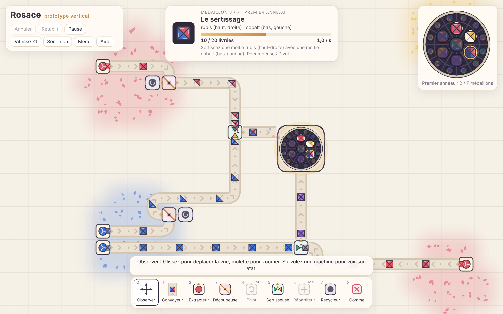

# Rosace

Jeu de construction d'usine détendu : on produit des pièces de vitrail pour illuminer, médaillon après médaillon, une immense rosace. Ce dépôt contient l'étude de conception, les maquettes et le **prototype vertical** jouable.



## Jouer

**En ligne :** https://vin100zz.github.io/shapez/ (les maquettes de l'étude sont dans https://vin100zz.github.io/shapez/maquettes/propositions.html). Le site est republié automatiquement à chaque envoi sur la branche principale.

**En local**, avec Node.js 22 :

```bash
npm install
```

```bash
npm run dev
```

Ouvrez ensuite l'adresse affichée (par défaut http://localhost:5173). La partie est sauvegardée automatiquement dans le navigateur.

`npm run build` produit dans `dist/` une version statique, à publier telle quelle (itch.io, GitHub Pages, n'importe quel serveur web).

## Commandes

| Action | Commande |
|---|---|
| Construire | clic ; glisser avec le convoyeur trace un chemin qui tourne tout seul |
| Pivoter l'orientation | R (Maj+R dans l'autre sens) |
| Effacer | clic droit, ou outil Gomme (X) |
| Annuler / rétablir | Ctrl+Z / Ctrl+Y |
| Se déplacer | clic milieu, Espace+glisser, flèches du clavier, outil Observer (Q) |
| Zoomer | molette ou pincement |
| Outils | 1 à 7 |
| Recentrer sur la rosace | C |
| Mode contemplation, pause, statistiques | H, P, F3 |

## Ce que contient le prototype

- **Machines :** Extracteur, Convoyeur, Découpeuse, Pivot, Sertisseuse (qui mélange les teintes superposées), Répartiteur, Recycleur.
- **Progression :** 7 médaillons scénarisés qui débloquent outils et améliorations, puis 12 médaillons générés, puis des commandes libres.
- **Carte infinie**, avec des gisements générés à partir d'une graine. Des couleurs secondaires apparaissent loin de la rosace.
- **Confort :** annulation illimitée, sauvegarde automatique, export et import, pause, vitesse ×1/×2/×4, carillon, mode contemplation, bac à sable, usine de démonstration (menu).

## Développement

| Commande | Rôle |
|---|---|
| `npm run dev` | serveur de développement |
| `npm test` | tests (pièces, convoyeurs, machines, progression, annulation, sauvegarde, déterminisme) |
| `npm run typecheck` | vérification TypeScript |
| `npm run bench` | banc de performance de la simulation |
| `npm run build` | version de production dans `dist/` |

```
src/core/     simulation pure, sans navigateur, testée
src/render/   rendu Canvas 2D
src/ui/       interface, entrées, sauvegardes locales
tests/        tests Vitest
bench/        banc de performance
docs/         étude et notes techniques
maquettes/    maquettes de l'étude
```

## Documents

- [Étude : analyse et propositions](docs/analyse-et-propositions.md)
- [Prototype vertical : notes techniques, mesures, limites](docs/prototype-vertical.md)
- Maquettes : [planches des trois propositions](maquettes/propositions.html) et [première maquette jouable](maquettes/rosace-prototype.html)
