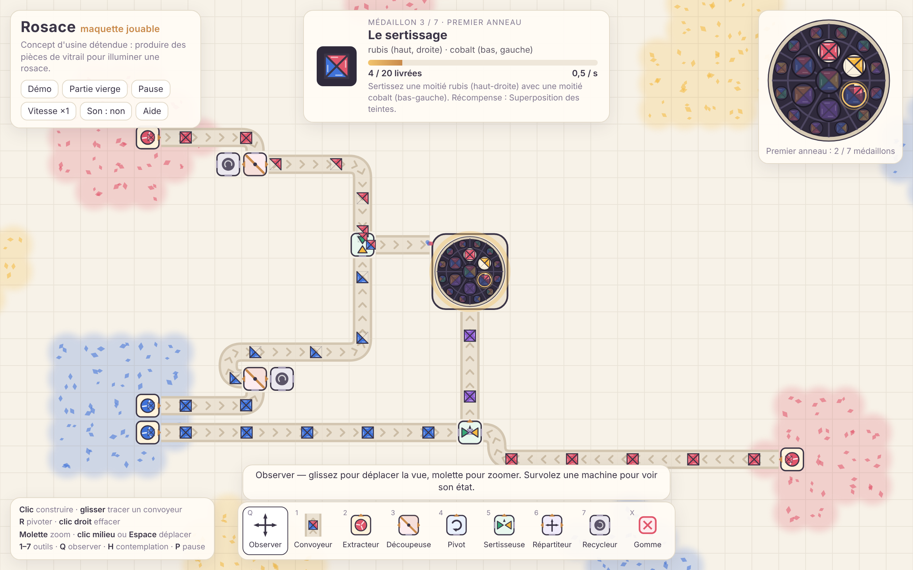
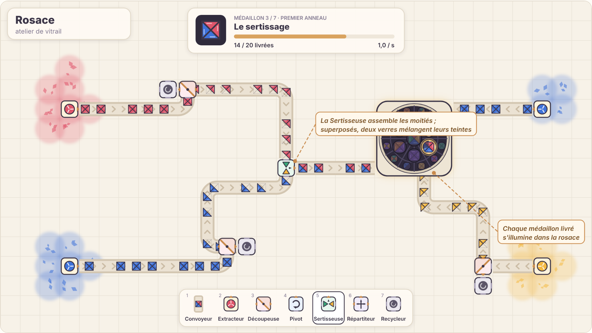
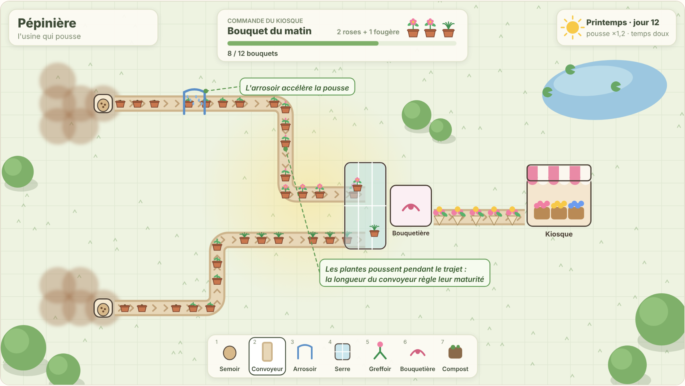
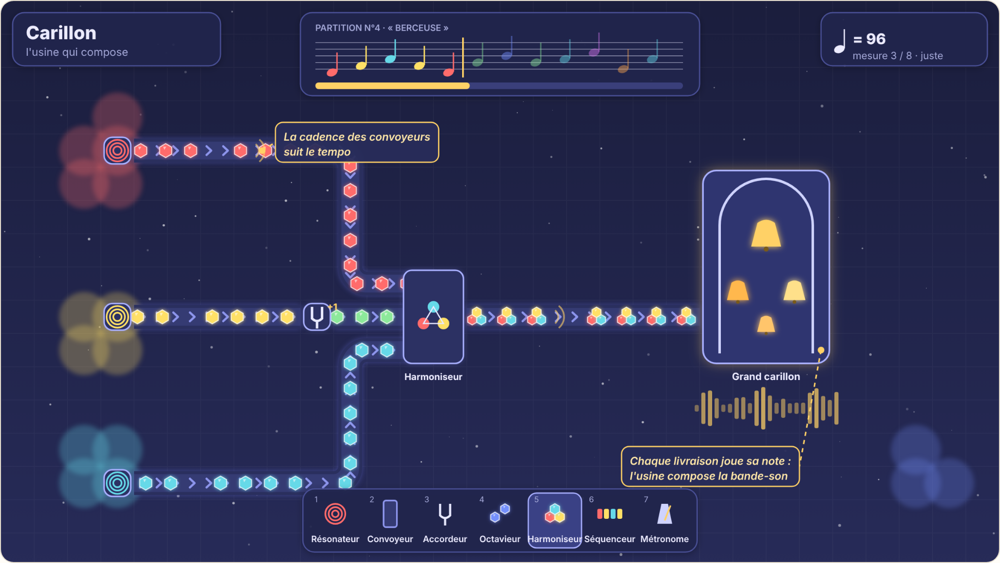

# Un jeu d'usine détendu « à la Shapez » : analyse et propositions

## En bref

- **Oui, c'est tout à fait faisable.** Le genre repose sur une simulation sur grille, sans physique complexe, sans IA ennemie et sans réseau. Une seule personne expérimentée peut le mener à bien. La difficulté ne vient pas de la technique : elle vient de **l'ergonomie de construction** et de la **courbe de progression**.
- **Il faut une identité propre.** On reprend les *principes* du genre (extraire, acheminer, transformer, livrer), pas le nom, les formes, les niveaux ni l'apparence de Shapez. C'est plus sûr juridiquement, et c'est aussi indispensable pour exister sur Steam à côté de Shapez 2.
- **Trois propositions originales** sont détaillées plus bas, chacune avec une maquette : **A · Rosace** (vitrail), **B · Pépinière** (plantes qui poussent sur les convoyeurs) et **C · Carillon** (une usine qui compose de la musique).
- **Je recommande Rosace.** C'est la plus proche du plaisir recherché et la plus lisible, avec un coût de production maîtrisé. Une **maquette jouable** valide déjà la boucle de jeu principale.

| Livrable | Fichier |
|---|---|
| Ce document | `docs/analyse-et-propositions.md` |
| Planches des trois propositions | `maquettes/propositions.html` |
| Maquette jouable de Rosace | `maquettes/rosace-prototype.html` |
| Captures | `maquettes/captures/` |

Les deux fichiers HTML s'ouvrent directement dans un navigateur : ils n'ont aucune dépendance et fonctionnent hors ligne.

---

## 1. Ce qui fait le charme du genre

| Ingrédient | Pourquoi ça détend |
|---|---|
| **Boucle claire** : extraire → acheminer → transformer → livrer → débloquer | On sait toujours quoi faire ensuite, sans qu'on nous presse. |
| **Aucun échec** : ni ennemis, ni pénurie (gisements infinis), ni chronomètre | L'erreur n'est pas punie. On peut s'arrêter à tout moment. |
| **Objets abstraits et lisibles** | On comprend l'usine d'un coup d'œil, même en dézoomant. |
| **Peu de règles, beaucoup de combinaisons** | La complexité vient du joueur, pas d'un manuel. |
| **Montée en échelle** | Le plaisir de réorganiser, d'optimiser, de copier-coller des modules. |
| **Retours sensoriels doux** | Flux continus, sons feutrés, musique ambiante : l'état de « flow ». |

## 2. Ce qu'il ne faut pas reprendre, et pourquoi c'est une chance

- **À éviter :** le nom, le logo, la direction artistique, le système de formes exact (quarts de cercle, carré, étoile, moulin, empilés en couches), la mise en page de l'interface, les niveaux et les textes.
- **Le code :** le code source du premier Shapez est publié sous licence GPL-3.0. En réutiliser une partie obligerait à publier tout le jeu sous la même licence. Mieux vaut repartir de zéro, ce que fait la maquette.
- **Les mécaniques de genre** (convoyeurs, machines de transformation, commandes à livrer) sont communes à des dizaines de jeux. Ce document n'est pas un avis juridique : avant une sortie commerciale, un rapide contrôle par un juriste reste prudent.
- **Le marché est occupé** (Shapez et Shapez 2, Factorio, Satisfactory, Mindustry, Dyson Sphere Program…). Un thème fort et un objectif final *visible* sont la meilleure façon de se distinguer.

## 3. Faisabilité technique

### Choix de la technologie

| Option | Atouts | Limites | Verdict |
|---|---|---|---|
| **TypeScript + Canvas/WebGL (PixiJS)** | Itération très rapide, démo jouable dans le navigateur (itch.io), version Steam via Tauri ou Electron | Moins naturel pour les consoles | **Recommandé pour démarrer** (continuité avec la maquette) |
| **Godot 4** | Moteur libre et gratuit, export natif bureau et mobile, éditeur intégré | Le web est possible, mais plus lourd | Très bonne alternative si l'on vise mobile ou consoles |
| Unity | Écosystème énorme | Plus lourd pour un jeu 2D sur grille ; conditions de licence à surveiller | Pas nécessaire ici |
| Rust + Bevy | Performances maximales | Développement plus lent | Surdimensionné |

**Conseil d'architecture :** écrire le **noyau de simulation en code pur**, sans dépendance au rendu, déterministe et testé. Le moteur de rendu reste alors interchangeable.

### Architecture recommandée

- **Simulation à pas fixe** (60 tics/s) découplée du rendu, qui est interpolé. C'est déjà le cas dans la maquette.
- **Monde découpé en blocs** de 32×32 cases, avec des gisements générés de façon procédurale et déterministe à partir d'une graine.
- **Convoyeurs regroupés en « chemins »** : chaque chemin ne stocke que les écarts entre pièces. Le coût dépend alors du nombre de chemins, pas du nombre de pièces, et un chemin bloqué « dort ». C'est la clé des performances en fin de partie.
- **Pièces immuables encodées en chaîne courte** (la maquette utilise `rrbb`). La comparaison est immédiate et chaque pièce n'est dessinée qu'une fois, puis mise en cache sous forme d'image.
- **Rendu WebGL par lots**, en ne dessinant que les blocs visibles. Au dézoom, un niveau de détail réduit montre les flux comme des traits colorés.
- **Sauvegarde** en JSON versionné et compressé, avec sauvegarde automatique. **Annuler/rétablir** illimité via un historique de commandes.
- **Objectif de performance** : environ 10 000 bâtiments et 50 000 pièces en mouvement à 60 images/s sur un portable moyen. C'est réaliste avec l'architecture « chemins ».

### Les vrais défis (où passe le temps)

1. **L'ergonomie de construction** : tracer des convoyeurs, les faire pivoter, copier-coller, gérer des plans réutilisables, annuler, faire passer des ponts. C'est la moitié du ressenti du jeu.
2. **La lisibilité à toutes les échelles**, du gros plan à l'usine entière.
3. **La courbe de progression** : enseigner sans tutoriel bavard, par des commandes bien choisies.
4. **Les performances en fin de partie** : elles se règlent par l'architecture, et c'est plus difficile à rattraper ensuite.

---

## 4. Trois propositions

Les planches ci-dessous viennent de `maquettes/propositions.html`. La page contient aussi le détail des machines, les forces et les risques de chaque concept.

### A · Rosace : l'atelier de vitrail *(recommandée)*

On produit des pièces de verre coloré pour illuminer, médaillon après médaillon, une immense rosace.

- **La pièce** est un carré partagé par ses deux diagonales en **quatre triangles**, chacun teinté ou vide. Cette géométrie diffère de celle de Shapez et évoque directement le vitrail et le patchwork.
- **Règle signature : superposer = mélanger.** Deux verres sertis l'un sur l'autre mélangent leurs teintes, comme de vrais verres superposés : rubis + cobalt = améthyste. Une seule règle remplace une machine de peinture.
- **L'objectif est visible** : la rosace se remplit et s'illumine. C'est idéal pour les captures et la bande-annonce.

### B · Pépinière : l'usine qui pousse

Des graines voyagent sur des convoyeurs en bois et **poussent pendant le trajet**. On compose des bouquets pour le kiosque du village.

- **Règle signature : le temps devient de l'espace.** La longueur d'un convoyeur règle la maturité d'une plante, et l'arrosoir ou la serre l'accélèrent.
- Les saisons changent les commandes. L'hiver est une saison calme, propice au réaménagement.
- Ce concept est très « cozy », mais les stades de croissance sont moins lisibles à petite échelle et demandent beaucoup d'illustrations.

### C · Carillon : l'usine qui compose

On extrait des cristaux sonores, on les accorde, on les harmonise. **Chaque livraison joue sa note**, en rythme.

- **Règle signature : le débit devient rythme.** Une usine équilibrée « sonne juste ».
- C'est le concept le plus original et le plus mémorable. C'est aussi le plus risqué : il faut vulgariser la théorie musicale, garder le jeu entièrement jouable sans le son (accessibilité), et la production audio est exigeante.

## 5. Comparatif et recommandation

| Critère | A · Rosace | B · Pépinière | C · Carillon |
|---|---|---|---|
| Proximité avec le plaisir « à la Shapez » | ●●●●● | ●●●○○ | ●●○○○ |
| Originalité | ●●●●○ | ●●●●○ | ●●●●● |
| Lisibilité à grande échelle | ●●●●● | ●●●○○ | ●●●○○ |
| Potentiel visuel (captures, bande-annonce) | ●●●●● | ●●●●○ | ●●●○○ |
| Coût de production | Modéré | Modéré, plus beaucoup d'illustrations | Élevé (audio et design) |
| Risque de design | Faible | Moyen | Élevé |

**Recommandation : A · Rosace**, en empruntant le meilleur des deux autres :

- de **C**, chaque livraison joue une note d'une gamme pentatonique, donc jamais dissonante. C'est déjà dans la maquette (bouton « Son ») ;
- de **B**, un cycle jour/nuit purement cosmétique qui change la lumière traversant la rosace.

---

## 6. Rosace : game design détaillé

### Règles de base

- **Couleurs primaires** extraites de gisements de sable : rubis, ambre, cobalt.
- **Mélanges** : rubis + ambre = corail, ambre + cobalt = émeraude, rubis + cobalt = améthyste. Un primaire mélangé à un secondaire qui le contient garde le secondaire. Tout autre mélange donne la *grisaille*.
- **Découpeuse** : elle coupe selon la diagonale qui sépare l'avant-droite de l'arrière-gauche de la machine. Chaque moitié sort du côté où elle se trouve. Tourner la machine change donc la diagonale, ce qui est intuitif spatialement.
- **Pivot** : un quart de tour dans le sens horaire. **Sertisseuse** : elle assemble deux pièces, et les triangles qui se recouvrent mélangent leurs teintes.
- **Choix « détente »** : une sortie de Découpeuse non raccordée est recyclée automatiquement. On évite ainsi le blocage frustrant de l'usine.

### Progression (premier anneau, tel que codé dans la maquette)

| # | Médaillon | Pièce demandée | Notion apprise | Débloque |
|---|---|---|---|---|
| 1 | Premier verre | vitre pleine rubis | extraire, acheminer | Découpeuse |
| 2 | La découpe | demi-vitre ambre | découper | Sertisseuse |
| 3 | Le sertissage | rubis en haut-droite, cobalt en bas-gauche | assembler | Superposition |
| 4 | La superposition | vitre améthyste | mélanger | Pivot |
| 5 | Crépuscule | corail et améthyste sur l'autre diagonale | orienter les coupes | Répartiteur |
| 6 | Le moulin | triangles alternés | double découpe | Cœur de la rosace |
| 7 | La lumière | quatre couleurs | synthèse | Second anneau |

Le **second anneau** propose 12 commandes générées automatiquement. Elles poussent à construire des lignes de production réutilisables.

### Pistes de contenu après le MVP

- **Verre dépoli** (givreuse) : un second attribut qui double les combinaisons sans nouvelle géométrie.
- **Motifs de grisaille** peints sur un triangle : feuille, étoile, fleur de lys.
- **Panneaux 2×2** assemblés à partir de quatre pièces, en fin de partie.
- **Plusieurs verrières comme chapitres** : chapelle, orangerie, gare, observatoire, chacune avec sa palette et sa lumière.
- **Mode bac à sable** et **défis-puzzles** à machines limitées, pour la rejouabilité.
- **Plans partageables** sous forme de code texte, pour la communauté.

### Le « détendu », concrètement

Le jeu n'a ni défaite, ni pénurie, ni chronomètre, ni ennemis. On peut annuler sans limite, mettre en pause librement et régler la vitesse (×1, ×2, ×4). Le mode contemplation masque l'interface (touche H). Chaque livraison joue un carillon pentatonique, et la musique s'adapte. Toutes ces fonctions, sauf l'annulation et la musique adaptative, sont déjà présentes dans la maquette.

### Accessibilité

- Un **motif optionnel par teinte** (points, rayures…) pour les joueurs daltoniens.
- Un contraste réglable et une taille d'interface ajustable.
- Des touches entièrement remappables.
- Un jeu **entièrement jouable sans le son**.

---

## 7. La maquette jouable (`maquettes/rosace-prototype.html`)

**Ce qu'elle démontre :**

- La simulation complète : extraction, convoyeurs avec fusions et virages automatiques, Découpeuse, Pivot, Sertisseuse (assemblage et mélange de teintes), Répartiteur, Recycleur et livraison à la rosace.
- La boucle de commandes : 7 médaillons scénarisés, puis 12 générés. La rosace se remplit dans le monde et dans le panneau.
- La construction : tracé de convoyeurs à la souris avec orientation automatique, rotation (R), gomme (clic droit), zoom, déplacement, pincement tactile.
- La détente : pause, vitesse, mode contemplation, carillon.

**Vérifications effectuées** (Chromium sans interface) :

- Aucune erreur JavaScript.
- L'usine de démonstration sertit seule les médaillons 3 et 4.
- En partie vierge, un extracteur posé à la souris et un convoyeur tracé à la main jusqu'à la rosace valident le premier médaillon.
- L'affichage reste utilisable sur un écran de téléphone.

**Limites volontaires :**

- Carte bornée (48×30), pas de sauvegarde, tout est débloqué d'emblée.
- Pas de ponts, de plans réutilisables ni d'annulation.
- Simulation case par case (chaque convoyeur gère ses propres pièces) : suffisante pour la maquette, à remplacer par l'architecture « chemins » pour la production.

## 8. Feuille de route indicative

Ces estimations supposent un développeur expérimenté à temps plein. Ce sont des ordres de grandeur, à recalibrer après la phase 1.

| Phase | Durée | Contenu | Critère de sortie |
|---|---|---|---|
| 0 · Maquette | Faite | Boucle de jeu, 6 machines, 19 commandes | Le concept se comprend en 2 minutes |
| 1 · Prototype vertical | 4 à 6 semaines | Noyau de simulation testé (chemins de convoyeurs), carte infinie par blocs, sauvegarde, annulation, déblocages | 5 à 10 testeurs jouent 1 h sans aide et en redemandent |
| 2 · Alpha | 2 à 3 mois | Ponts, plans réutilisables, premier chapitre complet, audio, accessibilité, options | Session de 3 à 4 h fluide, 60 images/s avec une grande usine |
| 3 · Démo publique | Environ 1 mois | Démo web (itch.io) et page Steam, captures, bande-annonce | Taux de liste de souhaits et retours |
| 4 · Version 1.0 | 6 à 9 mois | 3 ou 4 verrières, bac à sable, défis, finitions, localisation | Sortie |

## 9. Risques et parades

| Risque | Parade |
|---|---|
| Ressembler à un clone | Géométrie, thème, règles (superposition) et objectif (rosace) propres. Revue visuelle à chaque jalon. |
| Ennui en milieu de partie | Chapitres-verrières, commandes générées, défis-puzzles, plans à optimiser. |
| Frustration (blocages) | Recyclage automatique des sorties libres, aperçu des flux, annulation illimitée. |
| Performances en fin de partie | Architecture « chemins » dès la phase 1, tests de charge automatisés. |
| Dérive du périmètre | MVP figé (6 machines, 1 chapitre). Toute nouvelle machine doit apporter une notion nouvelle. |

## 10. Décisions à prendre ensuite

1. **Plateformes cibles** : web seul, Steam, mobile ? Ce choix oriente vers TypeScript/PixiJS ou vers Godot.
2. **Ambition** : petit jeu soigné (3 à 6 mois) ou jeu complet (12 à 18 mois) ?
3. **Concept** : valider Rosace, ou préférer un hybride (par exemple Rosace avec la croissance de Pépinière comme chapitre) ?
4. **Direction artistique et son** : tout en génératif comme la maquette, ou un illustrateur ou compositeur ?
